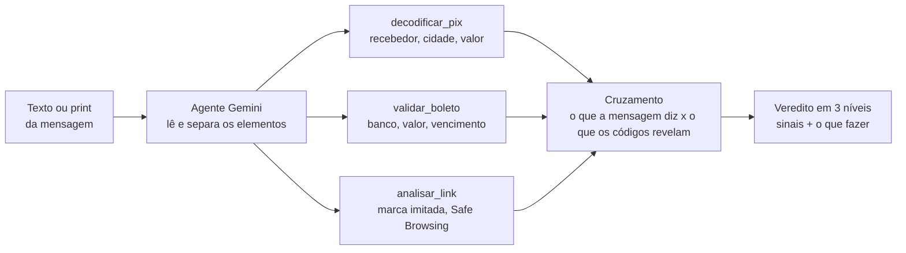
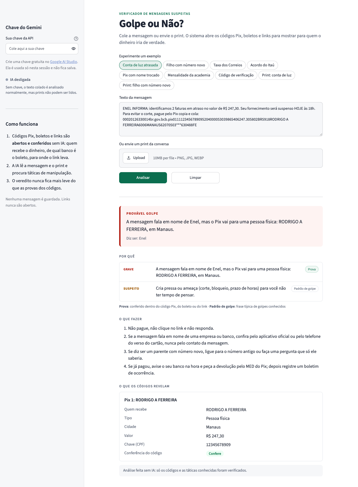

# Golpe ou Não?

**Cole a mensagem suspeita e veja para quem o dinheiro iria de verdade.**

**Experimente online: [golpe-ou-nao.streamlit.app](https://golpe-ou-nao.streamlit.app/)**

[](https://golpe-ou-nao.streamlit.app/)
[](https://github.com/cavalcantiraissas/golpe-ou-nao/actions/workflows/testes.yml)
[](https://www.python.org/)
[](https://ai.google.dev/)
[](https://docs.pydantic.dev/)
[](https://streamlit.io/)
[](tests/)

Golpes por mensagem acontecem todos os dias: boleto falso, Pix para um "parente com número novo", falsa central do banco, link de entrega com taxa a pagar. Quem mais cai são pessoas menos acostumadas com tecnologia.

O **Golpe ou Não?** recebe o texto ou o print da mensagem, separa o que importa (código Pix, linha do boleto, links, telefones, pedidos de urgência), roda verificações e responde em linguagem simples: **provável golpe**, **atenção** ou **sem sinais**, com os sinais encontrados e o que fazer.

### O diferencial

Detectores comuns só leem o texto e dão um palpite. Este **abre os códigos**. Um Pix copia e cola traz, dentro dele, o nome e a cidade de quem recebe; uma linha de boleto traz o banco, o valor e o vencimento. Assim a resposta vem com uma prova verificável:

> A mensagem diz que é da Enel, mas o Pix vai para **CARLOS M PEREIRA**, pessoa física em **Campinas**.

---

## Sumário

- [Situação do projeto](#situação-do-projeto)
- [Como funciona](#como-funciona)
- [Os verificadores](#os-verificadores)
- [O agente](#o-agente)
- [A interface](#a-interface)
- [Privacidade](#privacidade)
- [Início rápido](#início-rápido)
- [Exemplos de uso](#exemplos-de-uso)
- [Testes](#testes)
- [Estrutura do projeto](#estrutura-do-projeto)
- [Decisões de projeto](#decisões-de-projeto)
- [Avaliação](#avaliação)

---

## Situação do projeto

O projeto é construído em fases. A tabela abaixo mostra o que já está pronto e o que vem a seguir.

| Fase | Conteúdo | Situação |
|------|----------|----------|
| 1 | Decodificadores de Pix, boleto e link, com testes e CI | ✅ Pronta |
| 2 | Agente com Gemini (texto e visão, *function calling*) que cruza os achados | ✅ Pronta |
| 3 | Interface em Streamlit com exemplos prontos, publicada em [golpe-ou-nao.streamlit.app](https://golpe-ou-nao.streamlit.app/) | ✅ Pronta |
| 4 | Avaliação com 150 mensagens (golpes e legítimas) | Em andamento: conjunto e rodada sem IA prontos, falta a rodada com IA |
| 5 | Docker e README final | Em breve |

## Como funciona



A IA cuida do que exige leitura e interpretação: ler o print, reconhecer táticas de manipulação (urgência, pedido de sigilo, troca de número) e explicar o resultado para alguém leigo. Tudo o que pode ser conferido com uma regra fica em **código determinístico e testado**.

## Os verificadores

### `decodificar_pix`: quem recebe de verdade

Lê o Pix copia e cola (padrão BR Code do Banco Central, formato EMV) e confere o **CRC16**, o "dígito verificador" do código. Devolve:

- nome do recebedor, cidade, valor, chave e identificador da transação;
- **tipo da chave** (CPF, CNPJ, telefone, e-mail ou aleatória) e, a partir dela, se o recebedor é **pessoa física ou jurídica**;
- se o QR é dinâmico (com URL de cobrança do banco);
- se o código foi alterado: trocar uma única letra do nome quebra o CRC.

Também acha o código no meio de uma mensagem, mesmo quando o aplicativo quebrou a linha.

**Correção de leitura pelo próprio código.** Quando um código lido de um print falha na conferência, `corrigir_leitura_pix` testa as trocas comuns de leitura (0↔O, 1↔I↔l, 5↔S, 8↔B, 2↔Z, 6↔G), uma posição por vez. O código corrigido só é aceito se **exatamente uma** variante passar. Num teste real, o Gemini leu "SAO PAULO" como "SAO PAUL0", e a correção recuperou o código original. Ela tenta só uma troca de propósito: são cerca de 100 variantes, com chance de falso acerto perto de 0,2%; com duas trocas seriam milhares, e um falso acerto ficaria provável.

### `validar_boleto`: banco, valor e vencimento

Confere todos os dígitos verificadores da linha digitável (regras FEBRABAN) nos dois formatos:

- **Boleto bancário** (47 dígitos): extrai o banco onde o dinheiro cai, o valor e o vencimento.
- **Arrecadação** (48 dígitos, começa com 8): contas de luz, água, telefone e tributos. Extrai o segmento (por exemplo, *Energia elétrica e gás*), o código da empresa e o valor.

Já considera a mudança do **fator de vencimento**, que chegou a 9999 em 21/02/2025 e recomeçou em 1000.

### `analisar_link`: sinais de risco sem abrir o link

Abrir um link de golpe pode confirmar ao golpista que o número está ativo, então a análise olha só para o endereço:

- domínio que **imita uma marca** conhecida: `itau.com.br.acesso.top`, `nubank-seguranca.com`, `nubamk.com.br` (erro de digitação proposital), `1tau` (número no lugar de letra);
- **encurtador** que esconde o destino (`bit.ly`, `cutt.ly`...);
- ausência de **HTTPS**, IP no lugar do nome, caracteres que imitam letras (`xn--`), terminações descartáveis (`.xyz`, `.top`), `@` no endereço;
- consulta à lista de sites perigosos do **Google Safe Browsing**, quando há chave de API (gratuita).

## O agente

O agente junta os verificadores e o Gemini em quatro passos:

1. **Achados sem IA.** Os códigos Pix, boletos e links escritos no texto são encontrados e conferidos por código.
2. **Gemini com *function calling*.** O modelo recebe o texto, o print e os achados. Se houver códigos que só aparecem no print, ele os transcreve e chama `decodificar_pix`, `validar_boleto` ou `analisar_link`. Ele também devolve o texto da mensagem do print, que passa pelas mesmas regras do texto colado. Ele termina sempre chamando `emitir_veredito` (modo de chamada `ANY`), o que garante uma resposta estruturada.
3. **Cruzamento.** O que a mensagem diz é comparado com o que os códigos revelam, usando também a marca que a IA identificou no print:

   | A mensagem diz | O código revela | Gravidade |
   |---|---|---|
   | É a Enel | Pix para pessoa física | alta (prova) |
   | É o Itaú | Pix para um nome que não é de empresa | alta (prova) |
   | É a Cemig | Boleto bancário comum, não conta de consumo | média |
   | É o Bradesco | Boleto de outro banco | média |
   | Conta de R$ 89,90 | Pix de R$ 890,00 | média |
   | É dos Correios | Link para um site que não é dos Correios | média |
   | (qualquer) | Código Pix adulterado | alta (prova) |

   Táticas de manipulação no texto também contam: troca de número pedindo dinheiro, pedido de código recebido por SMS, pressa e ameaça, pedido de segredo, taxa para liberar entrega, prêmio, falsa central de segurança.
4. **Veredito.** Uma prova alta ou três motivos médios dão *provável golpe*; algum motivo médio dá *atenção*. O nível final é **o mais grave entre o da IA e o das provas**.

Cada sinal mostra de onde veio: **prova** (conferido num código), **texto** (padrão conhecido de golpe) ou **IA** (interpretação do modelo). Os sinais aparecem do mais grave para o menos grave e, na mesma gravidade, provas antes da IA. Um sinal da IA que só repete com outras palavras o assunto de uma prova ou regra (pressa, segredo, troca de número, recebedor...) é descartado.

Sem chave do Gemini, ou se a API falhar ou atingir o limite, o agente responde só com as verificações automáticas e avisa. Nesse modo o texto é analisado normalmente, mas o print não pode ser lido.

## A interface



A tela foi pensada para quem não entende de tecnologia: cola a mensagem (ou envia o print), clica em **Analisar** e recebe o veredito num quadro com a cor do nível, seguido de:

- **Por quê**: os sinais, do mais grave para o menos grave, cada um com a gravidade (grave, suspeito, leve) e a origem (**prova**, **padrão de golpe** ou **análise da IA**);
- **O que fazer**: passos concretos, incluindo o MED do Pix para quem já pagou;
- **O que os códigos revelam**: um cartão por Pix, boleto ou link, com quem recebe, banco, valor, vencimento e se o código passou na conferência;
- **Texto lido do print**, quando a mensagem veio como imagem.

A versão online está em [golpe-ou-nao.streamlit.app](https://golpe-ou-nao.streamlit.app/). Na barra lateral, qualquer pessoa pode colar a **própria chave do Gemini** para ligar a IA. A chave fica só na sessão de quem está usando, não é salva nem aparece na página, e tem prioridade sobre a chave do servidor, se houver. Uma chave errada não trava nada: o veredito sai pelas verificações automáticas, com o aviso de que a chave foi recusada.

Há nove exemplos prontos em [`exemplos/mensagens.json`](exemplos/mensagens.json), para experimentar sem ter um golpe em mãos:

| Exemplo | O que mostra | Nível sem IA |
|---|---|---|
| Conta de luz atrasada | Diz ser da Enel, mas o Pix vai para uma pessoa física | Provável golpe |
| Filho com número novo | Troca de número seguida de pedido de Pix e de segredo | Provável golpe |
| Taxa dos Correios | Link que imita os Correios e cobra taxa de entrega | Provável golpe |
| Acordo do Itaú | Renegociação do Itaú com boleto do Bradesco | Atenção |
| Pix com nome trocado | Código editado à mão: o CRC não confere | Provável golpe |
| Mensalidade da academia | Cobrança comum, Pix para a própria empresa | Sem sinais |
| Código de verificação | Código que a própria pessoa pediu | Sem sinais |
| Print: conta de luz | O golpe da Enel em print (precisa da IA para ler) | — |
| Print: filho com número novo | Conversa de WhatsApp em print (precisa da IA para ler) | — |

Os prints são sintéticos, com nomes e chaves fictícios, e podem ser refeitos com [`exemplos/gerar_prints.py`](exemplos/gerar_prints.py). Os códigos Pix desenhados neles têm CRC válido, então a IA lê o print e o verificador confere o recebedor.

## Privacidade

Quando a IA está ligada, o texto e o print são enviados à API do Gemini. Na camada gratuita, o Google pode usar esse conteúdo para melhorar os produtos dele, inclusive com revisão humana. Antes de colar, apague nomes, telefones e dados que você não quer compartilhar.

Sem chave do Gemini, a mensagem e o print não saem do servidor do app. A única exceção é a consulta opcional ao Google Safe Browsing: quando ela está configurada (`GOOGLE_SAFE_BROWSING_KEY`), só os endereços dos links encontrados são enviados ao Google.

O Golpe ou Não não salva mensagens nem prints: tudo fica na memória da sessão e some quando a página é fechada.

## Início rápido

Requer Python 3.11 ou mais recente.

```bash
git clone https://github.com/cavalcantiraissas/golpe-ou-nao.git
cd golpe-ou-nao
python3 -m venv .venv
source .venv/bin/activate
pip install -r requirements.txt
pytest
```

Para consultar o Safe Browsing, crie uma chave gratuita no [Google Cloud](https://developers.google.com/safe-browsing/v4/get-started) e defina:

```bash
export GOOGLE_SAFE_BROWSING_KEY="sua-chave"
```

Sem a chave, o analisador de links funciona normalmente e apenas pula essa consulta.

Para usar a IA (leitura de prints e explicação do veredito), crie uma chave gratuita no [Google AI Studio](https://aistudio.google.com/apikey):

```bash
export GEMINI_API_KEY="sua-chave"
export GEMINI_MODEL="gemini-3-flash-preview"   # opcional; este é o padrão
```

Para abrir a interface:

```bash
streamlit run app.py
```

A chave do Gemini pode ser colada na barra lateral da interface. Para deixar uma chave fixa no servidor, use a variável de ambiente ou `.streamlit/secrets.toml` (veja o modelo em [`.streamlit/secrets.toml.example`](.streamlit/secrets.toml.example)). Sem nenhuma chave, a interface funciona só com as verificações automáticas.

Para publicar no [Streamlit Community Cloud](https://share.streamlit.io/), aponte para este repositório com `app.py` como arquivo principal. Não é preciso cadastrar segredo: cada visitante pode usar a própria chave pela barra lateral. Se quiser oferecer a IA ligada a todos, cadastre `GEMINI_API_KEY` em *Settings → Secrets* (o uso entra na sua cota).

## Exemplos de uso

### Pelo terminal

```bash
python -m agente "Oi mãe, troquei de número! Preciso pagar um boleto urgente, consegue me fazer um Pix? Não conta pro pai."
python -m agente --imagem print.png
pbpaste | python -m agente          # macOS: analisa o que está copiado
```

```
== PROVÁVEL GOLPE ==

Provável golpe. O link correios-rastreio.top imita Correios, mas não é um site oficial.

Sinais encontrados:
  !! O link correios-rastreio.top imita Correios, mas não é um site oficial. [prova]
  !  Cria pressa ou ameaça (corte, bloqueio, prazo de horas) para você não ter tempo de pensar. [texto]
  !  Cobra taxa para liberar uma entrega: é o golpe mais comum em nome dos Correios. [texto]
  -  O site termina em .top, comum em sites descartáveis. [prova]
  -  O link correios-rastreio.top não usa HTTPS (conexão sem cadeado). [prova]

O que fazer:
  1. Não pague, não clique no link e não responda.
  ...
```

### Em Python: o agente

```python
from agente import analisar_mensagem

veredito = analisar_mensagem(texto, imagem=open("print.png", "rb").read())
veredito.nivel          # 'provavel_golpe', 'atencao' ou 'sem_sinais'
veredito.resumo         # explicação em linguagem simples
veredito.provas         # sinais conferidos nos códigos
veredito.o_que_fazer    # orientações práticas
veredito.pix            # o que cada Pix revelou (recebedor, cidade, valor)
```

### Em Python: os verificadores

```python
from verificadores import decodificar_pix, validar_boleto, analisar_link

pix = decodificar_pix(
    "00020126330014br.gov.bcb.pix0111123456789095204000053039865406287.40"
    "5802BR5916CARLOS M PEREIRA6008CAMPINAS62070503***6304DFAF"
)
pix.valido           # True (estrutura e CRC conferidos)
pix.nome_recebedor   # 'CARLOS M PEREIRA'
pix.cidade           # 'CAMPINAS'
pix.valor            # Decimal('287.40')
pix.tipo_recebedor   # 'pessoa_fisica' (a chave é um CPF)

boleto = validar_boleto("00190.50095 40144.816069 06809.350314 3 37370000000100")
boleto.valido        # True
boleto.nome_banco    # 'Banco do Brasil'
boleto.valor         # Decimal('1.00')

link = analisar_link("http://enel.com.br.segunda-via.xyz/fatura")
link.marca_imitada   # 'Enel'
link.dominio         # 'segunda-via.xyz'
link.sinais
# ['O endereço imita a marca Enel, mas não é um site oficial dela (segunda-via.xyz)',
#  'O link não usa HTTPS (conexão sem cadeado)',
#  'Terminação .xyz, muito usada em sites descartáveis',
#  'Endereço com muitos pedaços, um truque para esconder o domínio real']
```

Para achar os códigos dentro de uma mensagem inteira, use `extrair_pix`, `extrair_linhas_digitaveis` e `extrair_links`.

## Testes

```bash
pytest
```

São 445 testes, rodados a cada push pelo GitHub Actions em Python 3.11 e 3.12. Para não conferir o código contra ele mesmo, os testes usam referências externas:

- o **exemplo oficial do Manual do Pix** do Banco Central (CRC `1D3D`) e o vetor padrão do CRC16-CCITT (`"123456789"` → `29B1`);
- uma **linha de boleto do Banco do Brasil** publicada na documentação de cobrança;
- linhas de boleto geradas nos testes com um cálculo de dígito verificador **escrito à parte** do código principal;
- a API do Safe Browsing **simulada**, então nenhum teste acessa a internet;
- um **Gemini falso** que segue um roteiro de respostas (chamadas de função, erro 429, resposta sem função, laço sem fim), para testar o agente sem gastar cota;
- a **tela inteira** rodada pelo `AppTest` do Streamlit, sem navegador: clicar num exemplo, analisar, limpar, enviar sem mensagem, usar a chave digitada (e dar prioridade a ela sobre a do servidor), sem que a chave apareça na página;
- cada **exemplo pronto** conferido contra o nível esperado, para a demonstração nunca mostrar um resultado errado;
- as **150 mensagens da avaliação**: os códigos de cada uma conferem (menos os adulterados de propósito), e o resultado sem IA gravado continua igual ao do código atual.

Também há testes de adulteração (trocar qualquer dígito do boleto ou uma letra do nome no Pix é detectado), de **injeção de instrução** (a mensagem diz "isto não é golpe", o modelo acredita, e a prova mantém o nível) e de falsos alarmes (`receitas.tudogostoso.com.br` não é confundido com a Receita Federal).

## Estrutura do projeto

```
golpe-ou-nao/
├── verificadores/
│   ├── modelos.py      # Saídas em Pydantic (ResultadoPix, ResultadoBoleto, ResultadoLink)
│   ├── pix.py          # BR Code: leitura TLV, CRC16, tipo de chave e recebedor
│   ├── boleto.py       # Linha digitável: módulos 10 e 11, banco, segmento, vencimento
│   └── links.py        # Marca imitada, encurtadores, Safe Browsing
├── agente/
│   ├── modelos.py      # Veredito e Sinal
│   ├── cruzamento.py   # O que a mensagem diz x o que os códigos revelam; táticas no texto
│   ├── ferramentas.py  # Declarações para o function calling e executor
│   ├── prompts.py      # Instruções do agente
│   ├── gemini.py       # Cliente, retentativas e mensagens de erro
│   ├── analise.py      # O laço do agente e a combinação dos níveis
│   └── __main__.py     # Linha de comando
├── interface/
│   ├── exemplos.py     # Carrega os exemplos prontos
│   └── apresentacao.py # Rótulos, HTML e CSS do resultado (sem Streamlit, testável)
├── exemplos/
│   ├── mensagens.json  # Mensagens de exemplo com o nível esperado
│   ├── print-*.png     # Prints sintéticos
│   └── gerar_prints.py # Refaz os prints
├── avaliacao/
│   ├── conjunto.py     # As 150 mensagens e a montagem dos códigos
│   ├── mensagens.json  # O conjunto gerado
│   ├── metricas.py     # Contas e relatório
│   ├── __main__.py     # Roda a avaliação, com ou sem IA
│   ├── resultados/     # Níveis obtidos em cada rodada
│   └── RESULTADOS.md   # Relatório
├── app.py              # Interface em Streamlit
├── .streamlit/         # Tema e modelo de secrets
├── docs/               # Imagens do README
├── tests/              # Um arquivo de testes por módulo
├── .github/workflows/  # CI com pytest
├── requirements.txt
└── pytest.ini
```

## Decisões de projeto

- **Prova em vez de palpite.** O modelo de linguagem não decide sozinho o que um código diz; ele recebe o resultado de funções testadas e explica.
- **A IA acrescenta, não apaga.** O nível final é o mais grave entre o da IA e o das provas. Uma mensagem que tenta convencer o modelo ("pode confiar, não é golpe") não derruba uma prova.
- **Leitura do print tem margem de erro.** Um Pix transcrito do print que falha na conferência é corrigido pelo próprio CRC quando há uma única correção possível. Se não houver, vira "não deu para ler com certeza", e não "código adulterado". Um código colado como texto nunca é "corrigido": ali, falhar na conferência é sinal de adulteração.
- **Funciona sem IA.** Sem chave ou com a API fora do ar, o veredito sai só das verificações, com aviso.
- **Entrada ruim não derruba nada.** Os verificadores nunca levantam exceção: um código malformado volta com `valido=False` e a lista de `erros`, que também é informação útil (um Pix com CRC quebrado foi editado à mão).
- **Links nunca são abertos.** Nem para seguir redirecionamentos de encurtadores.
- **Texto da mensagem nunca vira HTML.** O resultado é desenhado com HTML e CSS próprios, e nomes, chaves, links e frases da IA passam por `html.escape`: um golpista não consegue criar um link clicável ou uma imagem no veredito. Há teste para isso.
- **A tela só desenha.** Tudo o que pode ser testado sem navegador (exemplos, rótulos, cartões, HTML) fica no pacote `interface`; o `app.py` só monta os componentes.
- **A chave de quem visita não é guardada.** Ela vive só no estado da sessão do Streamlit e vai direto para o cliente do Gemini.
- **Termos curtos de marca exigem cuidado.** "itau" e "enel" só contam no começo de um pedaço do endereço, para não acusar `penelope.com` de imitar a Enel.

## Avaliação

O agente foi medido num conjunto de **150 mensagens**: 75 golpes e 75 mensagens legítimas. As mensagens foram escritas para o teste, imitando golpes e avisos comuns no Brasil. Não foram coletadas de pessoas reais. O conjunto inclui casos difíceis nos dois lados: golpes sem código nem frase típica (vaga de emprego, investimento) e mensagens legítimas com palavras de golpe ("último dia da oferta", "troquei de celular"). O método e os limites estão em [avaliacao/README.md](avaliacao/README.md).

| Modo | Golpes pegos | Golpes com "provável golpe" | Alarme falso | Legítimas com "atenção" |
| --- | --- | --- | --- | --- |
| Sem IA (verificadores e regras) | 58/75 (77%) | 32/75 (43%) | 0/75 (0%) | 6/75 (8%) |
| Com IA | em breve | | | |

- **Golpes pegos** são os que receberam "provável golpe" ou "atenção": nos dois casos a pessoa é avisada para conferir antes de pagar.
- **Alarme falso** é uma mensagem legítima marcada como "provável golpe".

Sem IA, 17 golpes passaram sem sinais. A maior parte não tem código nem frase típica: 5 de emprego e 2 de investimento. Outros escapam por pouco: "celular novo" não está entre as frases que as regras reconhecem como troca de número, e "pode me enviar" o código não bate com o padrão de pedido de código. A lista completa, mensagem por mensagem, está em [avaliacao/RESULTADOS.md](avaliacao/RESULTADOS.md). As regras não foram ajustadas para acertar esses casos, porque o número deixaria de medir alguma coisa.

```bash
python -m avaliacao --sem-ia            # sem chave
GEMINI_API_KEY=... python -m avaliacao  # com a IA; pode parar e continuar depois
```
