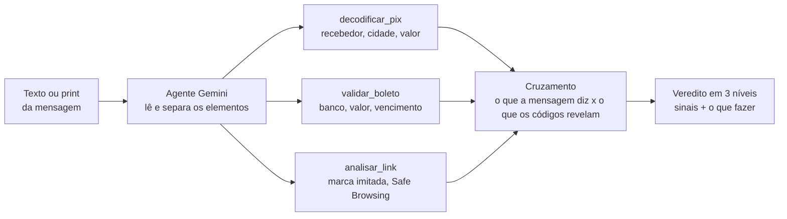

# Golpe ou Não?

**Cole a mensagem suspeita e veja para quem o dinheiro iria de verdade.**

[](https://github.com/cavalcantiraissas/golpe-ou-nao/actions/workflows/testes.yml)
[](https://www.python.org/)
[](https://docs.pydantic.dev/)
[](tests/)

Golpes por mensagem acontecem todos os dias: boleto falso, Pix para um "parente com número novo", falsa central do banco, link de entrega com taxa a pagar. Quem mais cai são pessoas menos acostumadas com tecnologia.

O **Golpe ou Não?** recebe o texto ou o print da mensagem, separa o que importa (código Pix, linha do boleto, links, telefones, pedidos de urgência), roda verificações e responde em linguagem simples: **provável golpe**, **atenção** ou **sem sinais**, com os sinais encontrados e o que fazer.

### O diferencial

Detectores comuns só leem o texto e dão um palpite. Este **abre os códigos**. Um Pix copia e cola traz, dentro dele, o nome e a cidade de quem recebe; uma linha de boleto traz o banco, o valor e o vencimento. Assim a resposta vem com uma prova verificável:

> A mensagem diz que é da Enel, mas o Pix vai para **CARLOS M PEREIRA**, pessoa física em **Campinas**.

---

## Sumário

- [Situação do projeto](#situação-do-projeto)
- [Como funciona](#como-funciona)
- [Os verificadores](#os-verificadores)
- [Início rápido](#início-rápido)
- [Exemplos de uso](#exemplos-de-uso)
- [Testes](#testes)
- [Estrutura do projeto](#estrutura-do-projeto)
- [Decisões de projeto](#decisões-de-projeto)
- [Como o projeto vai ser avaliado](#como-o-projeto-vai-ser-avaliado)

---

## Situação do projeto

O projeto é construído em fases, cada uma registrada em commits pequenos (um por arquivo) para mostrar a evolução.

| Fase | Conteúdo | Situação |
|------|----------|----------|
| 1 | Decodificadores de Pix, boleto e link, com testes e CI | ✅ Pronta |
| 2 | Agente com Gemini (texto e visão, *function calling*) que cruza os achados | Em breve |
| 3 | Interface em Streamlit com exemplos prontos para testar | Em breve |
| 4 | Avaliação com 150 mensagens reais (golpes e legítimas) | Em breve |
| 5 | Docker, demonstração online e README final | Em breve |

## Como funciona



A IA cuida do que exige leitura e interpretação: ler o print, reconhecer táticas de manipulação (urgência, pedido de sigilo, troca de número) e explicar o resultado para alguém leigo. Tudo o que pode ser conferido com uma regra fica em **código determinístico e testado**, que é a parte já pronta.

## Os verificadores

### `decodificar_pix`: quem recebe de verdade

Lê o Pix copia e cola (padrão BR Code do Banco Central, formato EMV) e confere o **CRC16**, o "dígito verificador" do código. Devolve:

- nome do recebedor, cidade, valor, chave e identificador da transação;
- **tipo da chave** (CPF, CNPJ, telefone, e-mail ou aleatória) e, a partir dela, se o recebedor é **pessoa física ou jurídica**;
- se o QR é dinâmico (com URL de cobrança do banco);
- se o código foi alterado: trocar uma única letra do nome quebra o CRC.

Também acha o código no meio de uma mensagem, mesmo quando o aplicativo quebrou a linha.

### `validar_boleto`: banco, valor e vencimento

Confere todos os dígitos verificadores da linha digitável (regras FEBRABAN) nos dois formatos:

- **Boleto bancário** (47 dígitos): extrai o banco onde o dinheiro cai, o valor e o vencimento.
- **Arrecadação** (48 dígitos, começa com 8): contas de luz, água, telefone e tributos. Extrai o segmento (por exemplo, *Energia elétrica e gás*), o código da empresa e o valor.

Já considera a mudança do **fator de vencimento**, que chegou a 9999 em 21/02/2025 e recomeçou em 1000.

### `analisar_link`: sinais de risco sem abrir o link

Abrir um link de golpe pode confirmar ao golpista que o número está ativo, então a análise olha só para o endereço:

- domínio que **imita uma marca** conhecida: `itau.com.br.acesso.top`, `nubank-seguranca.com`, `nubamk.com.br` (erro de digitação proposital), `1tau` (número no lugar de letra);
- **encurtador** que esconde o destino (`bit.ly`, `cutt.ly`...);
- ausência de **HTTPS**, IP no lugar do nome, caracteres que imitam letras (`xn--`), terminações descartáveis (`.xyz`, `.top`), `@` no endereço;
- consulta à lista de sites perigosos do **Google Safe Browsing**, quando há chave de API (gratuita).

## Início rápido

Requer Python 3.11 ou mais recente.

```bash
git clone https://github.com/cavalcantiraissas/golpe-ou-nao.git
cd golpe-ou-nao
python3 -m venv .venv
source .venv/bin/activate
pip install -r requirements.txt
pytest
```

Para consultar o Safe Browsing, crie uma chave gratuita no [Google Cloud](https://developers.google.com/safe-browsing/v4/get-started) e defina:

```bash
export GOOGLE_SAFE_BROWSING_KEY="sua-chave"
```

Sem a chave, o analisador de links funciona normalmente e apenas pula essa consulta.

## Exemplos de uso

```python
from verificadores import decodificar_pix, validar_boleto, analisar_link

pix = decodificar_pix(
    "00020126330014br.gov.bcb.pix0111123456789095204000053039865406287.40"
    "5802BR5916CARLOS M PEREIRA6008CAMPINAS62070503***6304DFAF"
)
pix.valido           # True (estrutura e CRC conferidos)
pix.nome_recebedor   # 'CARLOS M PEREIRA'
pix.cidade           # 'CAMPINAS'
pix.valor            # Decimal('287.40')
pix.tipo_recebedor   # 'pessoa_fisica' (a chave é um CPF)

boleto = validar_boleto("00190.50095 40144.816069 06809.350314 3 37370000000100")
boleto.valido        # True
boleto.nome_banco    # 'Banco do Brasil'
boleto.valor         # Decimal('1')

link = analisar_link("http://enel.com.br.segunda-via.xyz/fatura")
link.marca_imitada   # 'Enel'
link.dominio         # 'segunda-via.xyz'
link.sinais
# ['O endereço imita a marca Enel, mas não é um site oficial dela (segunda-via.xyz)',
#  'O link não usa HTTPS (conexão sem cadeado)',
#  'Terminação .xyz, muito usada em sites descartáveis',
#  'Endereço com muitos pedaços, um truque para esconder o domínio real']
```

Para achar os códigos dentro de uma mensagem inteira, use `extrair_pix`, `extrair_linhas_digitaveis` e `extrair_links`.

## Testes

```bash
pytest
```

São 133 testes, rodados a cada push pelo GitHub Actions em Python 3.11 e 3.12. Para não conferir o código contra ele mesmo, os testes usam referências externas:

- o **exemplo oficial do Manual do Pix** do Banco Central (CRC `1D3D`) e o vetor padrão do CRC16-CCITT (`"123456789"` → `29B1`);
- uma **linha de boleto do Banco do Brasil** publicada na documentação de cobrança;
- linhas de boleto geradas nos testes com um cálculo de dígito verificador **escrito à parte** do código principal;
- a API do Safe Browsing **simulada**, então nenhum teste acessa a internet.

Também há testes de adulteração (trocar qualquer dígito do boleto ou uma letra do nome no Pix é detectado) e de falsos alarmes (`receitas.tudogostoso.com.br` não é confundido com a Receita Federal).

## Estrutura do projeto

```
golpe-ou-nao/
├── verificadores/
│   ├── modelos.py      # Saídas em Pydantic (ResultadoPix, ResultadoBoleto, ResultadoLink)
│   ├── pix.py          # BR Code: leitura TLV, CRC16, tipo de chave e recebedor
│   ├── boleto.py       # Linha digitável: módulos 10 e 11, banco, segmento, vencimento
│   └── links.py        # Marca imitada, encurtadores, Safe Browsing
├── tests/              # Um arquivo de testes por verificador
├── .github/workflows/  # CI com pytest
├── requirements.txt
└── pytest.ini
```

## Decisões de projeto

- **Prova em vez de palpite.** O modelo de linguagem não decide sozinho o que um código diz; ele recebe o resultado de funções testadas e explica.
- **Entrada ruim não derruba nada.** Os verificadores nunca levantam exceção: um código malformado volta com `valido=False` e a lista de `erros`, que também é informação útil (um Pix com CRC quebrado foi editado à mão).
- **Links nunca são abertos.** Nem para seguir redirecionamentos de encurtadores.
- **Termos curtos de marca exigem cuidado.** "itau" e "enel" só contam no começo de um pedaço do endereço, para não acusar `penelope.com` de imitar a Enel.

## Como o projeto vai ser avaliado

Na fase 4, o agente será medido num conjunto de **150 mensagens**: metade golpes reais, tirados de alertas públicos de bancos e Procons, e metade mensagens legítimas. As métricas:

- **golpes detectados**, a mais importante: deixar passar um golpe custa dinheiro;
- **falsos alarmes** em mensagens legítimas: alarme demais faz a pessoa parar de confiar no aviso;
- **acerto dos decodificadores**, que deve ser de 100% nos testes.
